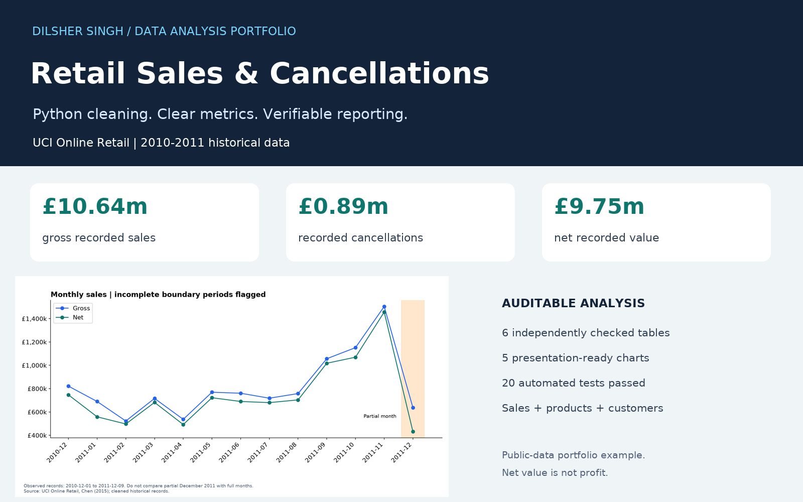

# Retail Sales and Cancellation Analysis

**Python portfolio project by Dilsher Singh**

Turn invoice lines into an auditable report of sales, cancellations, products and purchasing patterns.

**Tools:** Python · pandas · data cleaning · financial metric validation · visualization



## Selected findings

- **£9,748,131.07 net recorded value**, calculated as £10,642,110.80 gross sales less £893,979.73 recorded cancellations.
- **8.40% cancellation-value share** of gross sales. This is not a physical return rate.
- **65.58% repeat-purchaser share**: 2,845 of 4,338 identified purchasing customers had at least two positive-sales invoices. Customer IDs cover 83.51% of gross value.

The source contains **541,909 invoice lines**; **534,129** remain after cleaning. The observation window is **1 December 2010–9 December 2011**; the final month is incomplete.

## Work demonstrated

- Preserve and classify cancellations, with separate gross and net metrics.
- Calculate monetary values using integer pence and maintain a cleaning audit.
- Keep anonymous sales in totals while restricting customer metrics to identified purchasers.
- Export analytical tables and charts, supported by tests and independent workbook-to-report checks.

Original coursework supplied by Dilsher Singh; the portfolio edition includes AI-assisted refactoring, validation and presentation.

## Reproduce the analysis

Use Python 3.13 and the pinned requirements. From the repository root:

```bash
cd Retail_Project_Portfolio
python -m pip install -r requirements.txt
python main.py --data data/sample.csv --output sample_reports
python -m pytest -q
```

The included sample demonstrates the workflow; it does **not** reproduce the full-data findings above. Follow the [full setup instructions](Retail_Project_Portfolio/README.md) to obtain the UCI workbook, reproduce the full analysis, and run independent export verification.

## Limitations

Net recorded value is **not profit or audited revenue**. Cancellations are not matched to original invoices; repeat purchases are not retention. Exact duplicate removal is an assumption because no unique invoice-line ID is available. Historical patterns do not establish future performance or commercial savings.

## Explore the project

- [Full methodology, results and setup](Retail_Project_Portfolio/README.md)
- [Python source](Retail_Project_Portfolio/pipeline/)
- [Charts and exported reports](Retail_Project_Portfolio/reports/)
- [Methodology](Retail_Project_Portfolio/docs/METHODOLOGY.md) · [Data notes](Retail_Project_Portfolio/data/README.md) · [Tests](Retail_Project_Portfolio/tests/)

**Data attribution:** Chen, D. (2015), Online Retail, UCI Machine Learning Repository, [doi:10.24432/C5BW33](https://doi.org/10.24432/C5BW33), CC BY 4.0.
