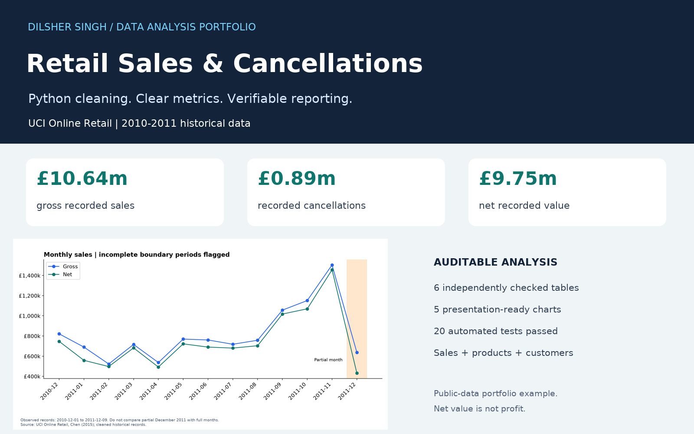
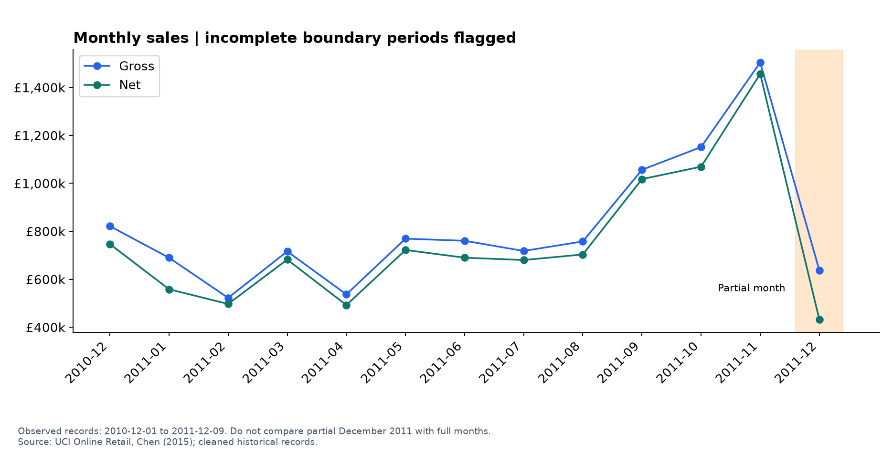

# Retail Sales and Cancellation Analysis

A reproducible Python portfolio project that turns invoice lines into clear sales,
cancellation, product and customer reports.



## Business question

How much recorded sales value remains after cancellations, which products and
markets contribute most, and how do purchasing patterns vary over the observed
period? The deliverable is an auditable management report, not an accounting
statement or predictive model.

## Verified results

| Metric | Result |
| --- | ---: |
| Source invoice lines | 541,909 |
| Retained invoice lines | 534,129 |
| Gross recorded sales | £10,642,110.80 |
| Recorded cancellation value | £893,979.73 |
| Net recorded value | £9,748,131.07 |
| Cancellation value / gross | 8.40% |
| Positive-sales invoices | 19,960 |
| Average gross invoice | £533.17 |
| Identified purchasing customers | 4,338 |
| Repeat share among identified purchasers | 65.58% |

Window: **1 December 2010-9 December 2011**. December 2011 is partial.
Overall values include nonstandard stock codes, exported separately. Net recorded
value is gross less recorded cancellations; it is not profit or audited recognized
revenue. Cancellations are not matched to original invoices.

## Findings

- Recorded cancellations equal 8.40% of gross value.
- REGENCY CAKESTAND 3 TIER (22423) leads merchandise products by net value: £164,459.49.
- 2,845 of 4,338 identified purchasing customers have at least two positive-sales invoices. Customer IDs cover 83.51% of gross value.



## Improvements over the original coursework

- Preserve and classify cancellations instead of deleting negative quantities.
- Separate gross, cancellation and net values with exact integer-pence arithmetic.
- Keep anonymous sales in totals while scoping customer metrics to identified records.
- Group products by StockCode, with a consistent description chosen for display.
- Report nonstandard codes separately and flag incomplete boundary months.
- Add meaningful tests, a sequential audit and independent raw-data verification.

## Run locally

Use Python 3.13 with the tested packages in `requirements.txt`.

```bash
python -m venv .venv
```

Activate on Windows PowerShell: `.venv\Scripts\Activate.ps1`.
On macOS/Linux: `source .venv/bin/activate`.

```bash
python -m pip install -r requirements.txt
python main.py
python -m pytest -q
python tools/verify_exports.py
python tools/build_portfolio.py
```

The full workbook is retained in the local working copy but excluded from Git
and the publication ZIP. Download it from the [UCI dataset page](https://archive.ics.uci.edu/dataset/352/online+retail)
and save it as `data/Online_Retail.xlsx` to reproduce the published results.
The included sample is a demonstration, not a representative dataset:

```bash
python main.py --data data/sample.csv --output sample_reports
```

Use the separate output directory so the full-data report remains intact.

## Files

| Location | Purpose |
| --- | --- |
| `main.py` | Load, clean, analyze and export |
| `pipeline/clean.py` | Audited data validation and currency rules |
| `pipeline/analyze.py` | Six analytical tables |
| `pipeline/visualize.py` | Five charts |
| `tests/` | Data quality and metric contract tests |
| `tools/verify_exports.py` | Independent workbook-to-report calculations |
| `reports/` | Tables, charts, audit, metadata and cover |
| `docs/Case_Study.html` | Standalone case study with embedded images |
| `docs/UPWORK_LISTING.txt` | Portfolio description and suggested attachments |

## Validation and limitations

20 automated tests passed. An independent openpyxl/Decimal calculation checked
all six analytical tables and 19,417 numeric values. Money and counts
match exactly; rate tolerance is 1e-7. See [verification](reports/verification.json).

Exact duplicate removal is an assumption: no unique line ID is available.
Nonpositive-price rows are excluded from financial reporting. Repeat purchases
are not retention; cancellation-value share is not a physical return rate.
Only historical associations are shown. No commercial savings are claimed.
Read [methodology](docs/METHODOLOGY.md) and [data notes](data/README.md).

## Attribution

Original coursework supplied by Dilsher Singh; this edition includes AI-assisted
refactoring, validation and presentation. Credit any original collaborators and
describe personal contributions accurately before publication. No new code
licence has been assigned; confirm ownership before selecting one.

Dataset: Chen, D. (2015). *Online Retail*. UCI Machine Learning Repository.
https://doi.org/10.24432/C5BW33. Dataset licence: CC BY 4.0. The sample and derived
reports are adaptations of this data.
